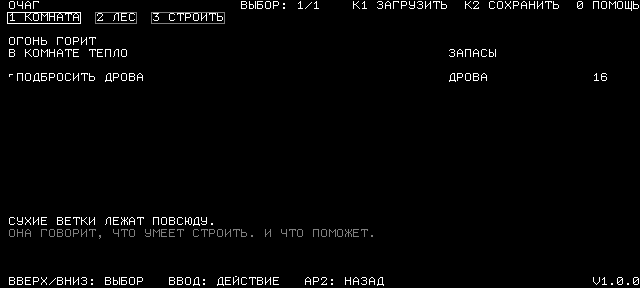
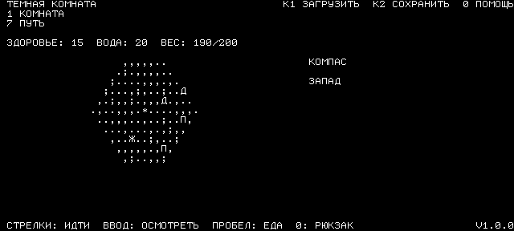
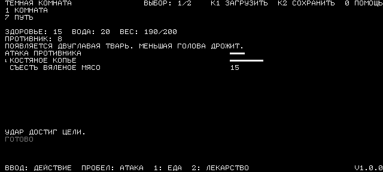

# A Dark Room для «Электроники МС-0511»

**IF SOMEONE NEEDS EN PORT - RAISE AN ISSUE FOR THAT - I'LL SUPPORT**

Русскоязычный порт текстовой игры **A Dark Room** для УКНЦ. Вместо картинок — белые буквы на чёрном экране, короткие сообщения и решения, от которых зависит жизнь небольшого поселения. Игра работает как самостоятельная программа под РТ-11.

## Всё начинается с огня

Вы просыпаетесь в тёмной, холодной комнате. Голова раскалывается. Рядом — угасающий очаг. Сначала нужно лишь разжечь огонь и не дать ему погаснуть.

Со временем у огня появляется незнакомка, за стенами открывается лес, а одинокое убежище постепенно превращается в поселение. Понадобятся дрова, еда, инструменты и люди, готовые работать. Когда вы сможете снарядить первый поход, мир окажется гораздо больше этой комнаты — и гораздо опаснее.

История раскрывается через находки, встречи и короткие описания. Лучше узнавать её постепенно: даже привычные действия со временем получают новый смысл.

## Очаг и поселение

Поддерживайте огонь, собирайте дрова, ставьте ловушки и стройте хижины. Новые жители позволяют распределять работу: добывать ресурсы, обрабатывать материалы и готовить припасы. Постройки и предметы открывают новые возможности, поэтому список доступных действий постепенно растёт.

Серым показаны действия, для которых пока не хватает ресурсов или условий. Полоска рядом с действием показывает оставшееся время ожидания. Числа рядом с предметами обозначают количество, а пять строк внизу экрана сообщают о последних событиях.



*Домашний экран. Здесь вы поддерживаете огонь и следите за запасами; новые разделы появляются по мере развития поселения.*

## Снаряжение и путешествия

Компас открывает раздел «ПУТЬ». Перед выходом возьмите вяленое мясо, оружие и полезные припасы. Рюкзак ограничен по весу: строка «ВЕС» показывает, сколько уже взято и сколько можно нести. Стрелка вправо добавляет выбранный предмет, влево — возвращает его в домашние запасы.

На карте вы обозначены звёздочкой. Передвижение раскрывает окрестности и расходует припасы. Следите за здоровьем, водой и едой; не уходите слишком далеко без возможности вернуться. Найденные места можно исследовать, а добычу — принести домой. При гибели припасы теряются, и часть результатов незавершённого похода откатывается.



*Карта показывает уже открытые окрестности. Справа видны показания компаса, сверху — состояние путешественника, снизу — последние сообщения.*

## Встречи и бой

Враги зависят от местности и расстояния до дома. Леса, равнины и пустоши населены разными существами; дальние путешествия опаснее первых вылазок.

Перед встречей появляется описание и кнопка «БОЙ». Пока вы не нажмёте «ВВОД», сражение не начнётся. Затем бой идёт в реальном времени: выбирайте оружие и следите за полосками ожидания своих ударов и атаки противника. «ПРОБЕЛ» применяет первое готовое оружие. После победы можно забрать добычу, если в рюкзаке осталось место.



*Экран боя. Полоска «АТАКА ПРОТИВНИКА» помогает понять, когда ждать следующего удара; оружие тоже требует времени на подготовку.*

## Управление

| Клавиши | Действие |
| --- | --- |
| ВВЕРХ / ВНИЗ | Выбрать строку; длинные списки прокручиваются автоматически |
| ВВОД | Выполнить выбранное действие или подтвердить окно |
| ВЛЕВО / ВПРАВО | Уменьшить или увеличить количество в «ПУТЬ» и назначение работников |
| Стрелки на карте | Переместиться |
| ПРОБЕЛ | Действие по ситуации: поддержать огонь, собрать дрова, атаковать, поесть на карте или взять добычу |
| Цифры разделов | Перейти в уже открытый раздел |
| 0 | Открыть помощь; во время путешествия — сумку |
| АР2 | Вернуться из списка |
| К1 / F1 | Загрузить сохранение |
| К2 / F2 | Сохранить игру |
| СТОП | Выйти в РТ-11 |

В компьютерном эмуляторе клавиша Tab соответствует АР2, а Esc — СТОП. В окне сохранения или загрузки отмена закрывает окно. Помощь, выбор сохранения и окна подтверждения приостанавливают игровой процесс.

## Сохранения и запуск

Доступны **пять ручных сохранений**. Выберите место стрелками вверх и вниз и подтвердите вводом. Автоматического сохранения нет. Сохранения записываются на игровой дисковый образ, поэтому для резервной копии достаточно скопировать его целиком. Сохранения от другой сборки могут быть несовместимы.

Для начала игры используйте чистый образ `darkroom-v1.0.0.dsk`: все пять мест в нём пусты. Подключите его как загрузочную дискету УКНЦ. После загрузки РТ-11 игра запускается автоматически; на приветственном экране нажмите «ВВОД».

Если файлы игры перенесены на другой диск, рядом должны находиться `DARKRM.SAV` и `DARKRM.DAT`. Из командной строки РТ-11 игру можно запустить командой:

```text
RUN DARKRM
```

## Авторы

Порт для «Электроники МС-0511»: **Сергей Лемешев и ChatGPT Codex**. Пенза, 25 октября 2026 года. Версия **V1.0.0**.

Оригинальная игра: **Майкл Таунсенд, студия Doublespeak Games и участники проекта**. [Играть в оригинал](https://adarkroom.doublespeakgames.com/) · [Исходный код оригинала](https://github.com/doublespeakgames/adarkroom).

Исходный код порта распространяется на условиях [Mozilla Public License 2.0](LICENCE.md) (русский перевод и английский оригинал). [Сведения для разработчиков](AI-DEVELOPERS.md) содержат инструкции по сборке, устройству игры и проверкам.
